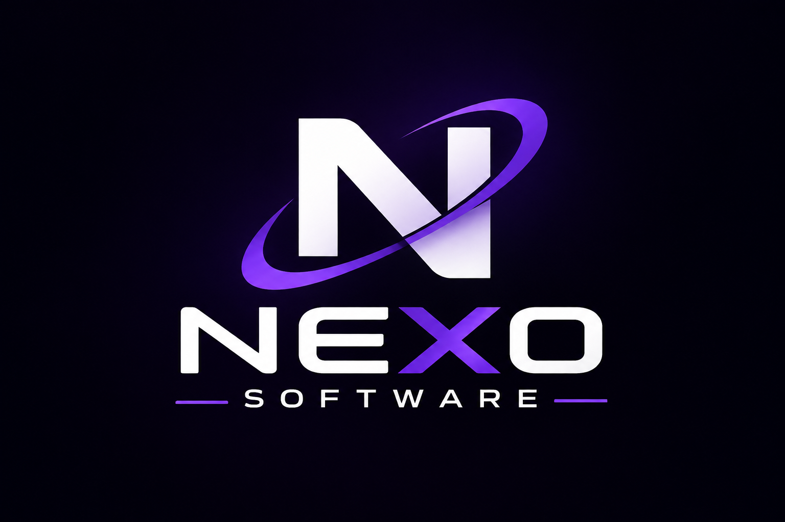

  

  # NEXO SOFTWARE

  ### Digital solutions built around your business.

  **Technology · Innovation · Solutions**

  [About](#about) · [What we do](#what-we-do) · [Technology](#technology) · [Projects](#projects) · [Contact](#contact)

---

## About

Nexo Software designs and builds practical digital tools that help businesses work smarter. We turn everyday operational challenges into clear, reliable software—from automating repetitive tasks to bringing essential business information into one place.

Our focus is simple: understand the process, build the right solution, and make it useful in the real world.

## What we do

- **Custom software** — purpose-built applications for your workflow.
- **Process automation** — fewer repetitive tasks, more time for meaningful work.
- **Data processing** — organize information and make it easier to use.
- **Inventory management** — keep products, movements, and records under control.
- **Business management systems** — connect day-to-day operations with tools that fit.

## Technology

We work with a focused foundation of tools and technologies:

**Rust** · **Python** · **SQL**

## Projects

We're building. Project highlights will be shared here as they become available.

## Contact

Have a process to improve or an idea to bring to life? Get in touch to discuss your project and explore the right solution.

[Email us](mailto:nicoavellanas123@gmail.com)

---

  <strong>NEXO SOFTWARE</strong> 
  Technology · Innovation · Solutions

